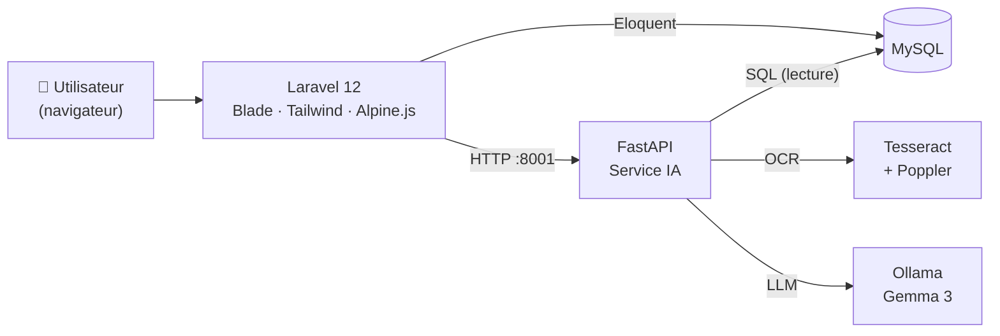

<div align="center">

#  DEKRA CentrePilot AI

**Une plateforme de gestion administrative assistée par IA pour un centre de contrôle technique : archivage de documents avec OCR, facturation et suivi de la TVA, ordres de virement, rappels et assistant en langage naturel.**

</div>

---

## 📑 Sommaire

- [Présentation](#-présentation)
- [Fonctionnalités](#-fonctionnalités)
- [Architecture](#-architecture)
- [Technologies utilisées](#-technologies-utilisées)
- [Structure du projet](#-structure-du-projet)
- [Installation](#-installation)
- [Utilisation](#-utilisation)
- [Sauvegarde et restauration](#-sauvegarde-et-restauration)
- [Tests](#-tests)
- [Pistes d'amélioration](#-pistes-damélioration)
- [Auteur](#-auteur)

---

## 🎯 Présentation

**CentrePilot AI** a été réalisé lors d'un stage chez **DEKRA** (*Contrôle Automobile et Expertise*). L'application centralise le travail administratif quotidien d'un centre de contrôle technique dans une seule interface web :

- archiver des documents scannés (titres de propriété, factures, reçus, virements) et les rendre **consultables grâce à l'OCR**,
- émettre des **factures** avec calcul automatique de la TVA et export PDF,
- générer des **ordres de virement bancaire** pré-remplis (PDF),
- suivre les **versements reçus**, les **rappels** et la **TVA mensuelle**,
- poser des questions en français à un **assistant IA** qui répond à partir des données de l'application,
- sécuriser les données grâce à une **corbeille**, un **journal des actions** et des **sauvegardes**.

L'application repose sur deux services : une application web **Laravel** (interface et logique métier) et un microservice **FastAPI** qui gère l'OCR et le modèle de langage local (**Gemma 3 via Ollama**). Les documents et les données restent ainsi hébergés en local.

> L'interface est en français et les montants sont exprimés en dirhams marocains (DH).

---

## ✨ Fonctionnalités

| Module | Description |
|---|---|
| 🔐 **Authentification** | Connexion, inscription, vérification d'e-mail, réinitialisation du mot de passe et gestion du profil (Laravel Breeze). Les enregistrements sont rattachés à chaque utilisateur. |
| 📊 **Tableau de bord** | Indicateurs : nombre de documents, documents analysés par OCR, documents ajoutés cette semaine, e-mails, utilisateurs, factures, factures du mois, **TVA à déclarer** du mois, virements en attente, rappels à venir, ainsi qu'un **graphique d'évolution des factures sur 12 mois** (Chart.js). |
| 📁 **Archivage de documents** | Import de PDF et d'images, **OCR à chaque import** (Tesseract, français + anglais), recherche plein texte sur le titre, le type, la catégorie, le propriétaire, l'immatriculation, la marque, le modèle, le texte OCR et la facture liée. Pour les *Titres de propriété*, le nom du propriétaire, le numéro d'immatriculation, la marque et le modèle sont extraits automatiquement. Téléchargement et modification des documents. |
| 🤖 **Classement automatique par IA** | En choisissant le type *Auto*, le modèle détecte le type de document (*Titre de propriété, Facture, Reçu, Virement, Autre*), une catégorie et un titre normalisé. |
| 🧾 **Factures** | Création, modification et suppression (numéro unique, client, objet, HT / TVA / TTC, date, statut *Payée / Non payée*, type de véhicule *Moto*), **export PDF** (DomPDF), taux de TVA lu dans une table paramétrable. |
| 💸 **Ordres de virement** | PDF d'ordre de virement pré-remplis à partir de modèles officiels (FPDI), **montant écrit en toutes lettres** en français, statut *En attente / Traité*. |
| 💰 **Versements reçus** | Journal des paiements reçus (client, montant, date, référence, RIB, motif). |
| 🧮 **Suivi de la TVA** | Récapitulatif mensuel de la TVA, taux de TVA Moto modifiable, **export PDF** de l'état de TVA. |
| ⏰ **Rappels** | Création de rappels avec une date d'échéance, marquage comme terminé, affichage des rappels à venir sur le tableau de bord. |
| ✉️ **E-mails** | Rédaction à partir de modèles, **génération de l'objet et du corps par l'IA**, pièce jointe (document, facture PDF ou ordre de virement PDF), envoi via Laravel Mail et historique consultable. |
| 💬 **Assistant IA** | Questions en français. Les questions courantes (comptages, factures par client ou par mois, TVA, virements, versements, rappels, propriétaires, marques, modèles, immatriculations) sont traitées par **requêtes SQL directes** ; les autres sont envoyées à **Gemma 3** avec les données de la base en contexte. L'historique des questions est enregistré par utilisateur. |
| 🔍 **Analyse de document** | Import d'un PDF ou d'une image dans l'assistant : l'OCR et le modèle extraient un **JSON structuré** (type de document, catégorie, titre, numéro de facture, date, client, fournisseur, HT, taux de TVA, TVA, TTC, mode de paiement, référence). Les champs absents restent à `null` : rien n'est inventé. |
| ⚠️ **Contrôles de cohérence** | Sur les factures, virements et versements : alerte en cas de montant nul ou négatif, de montant **supérieur à 5 fois la moyenne** de l'utilisateur, ou de **doublon potentiel** (même client ou bénéficiaire, même montant, à ±3 jours). |
| 🗑️ **Corbeille** | Suppression logique des factures, virements, versements, documents et rappels ; restauration ou suppression définitive. |
| 📜 **Journal des actions** | Enregistrement automatique des créations, modifications, suppressions et restaurations sur les principaux enregistrements. |
| 💾 **Sauvegardes** | La commande `backup:run` exporte la base MySQL et copie les documents archivés dans un dossier horodaté (conserve les **10 dernières**). Les sauvegardes sont listées dans l'application et une [procédure de restauration](dekra-centrepilot-ai/docs/procedure-restauration-dekra.md) est documentée. |

---

## 🏗️ Architecture



**Déroulement de l'import d'un document :**

1. L'utilisateur importe un fichier dans Laravel, qui le stocke sur le disque `public`.
2. Laravel envoie le fichier à `POST /ocr` sur le service FastAPI : Tesseract extrait le texte (les PDF sont convertis en images avec Poppler).
3. Si le type choisi est *Auto*, Laravel appelle `POST /classifier-document` : Gemma 3 renvoie le type, la catégorie et le titre.
4. Le document et son texte OCR sont enregistrés dans MySQL et deviennent consultables par la recherche.

**Points d'entrée du service FastAPI**

| Endpoint | Rôle |
|---|---|
| `GET /` | Message de test |
| `POST /ocr` | OCR et extraction du propriétaire, de l'immatriculation, de la marque et du modèle |
| `POST /assistant` | Réponses par requêtes SQL, repli sur le modèle de langage |
| `POST /assistant-ia` | Réponse directe du modèle avec véhicules et factures en contexte |
| `POST /generer-mail` | E-mail généré par l'IA (objet + corps) |
| `POST /classifier-document` | Type, catégorie et titre du document |
| `POST /analyser-document` | OCR et extraction JSON structurée |

---

## 🛠️ Technologies utilisées

| Couche | Technologies |
|---|---|
| **Backend** | PHP 8.2+, Laravel 12, Laravel Breeze, Eloquent ORM, Laravel Mail |
| **Frontend** | Blade, Tailwind CSS, Alpine.js, Vite, Axios, Chart.js |
| **Service IA** | Python, FastAPI, Pydantic, SQLAlchemy + PyMySQL |
| **IA / OCR** | Ollama (**Gemma 3**), Tesseract OCR (`fra+eng`), pytesseract, pdf2image / Poppler, Pillow |
| **Base de données** | MySQL (SQLite est la valeur par défaut de Laravel dans `.env.example`) |
| **PDF** | barryvdh/laravel-dompdf, setasign/FPDF + FPDI, kwn/number-to-words |
| **Tests et outils** | Pest, Laravel Pint, Laravel Pail, Laravel Sail |

---

## 📂 Structure du projet

```
Stage-DEKRA/
├── ai-service/                     # Microservice FastAPI (OCR + LLM)
│   └── main.py
└── dekra-centrepilot-ai/           # Application web Laravel
    ├── app/
    │   ├── Console/Commands/       # SauvegardeAutomatique (backup:run)
    │   ├── Http/Controllers/       # Document, Invoice, Virement, Versement, Tva,
    │   │                           # Rappel, Email, AssistantIA, Dashboard,
    │   │                           # Corbeille, Journal, Backup, Auth/...
    │   ├── Models/                 # Document, Invoice, Virement, Versement, Rappel,
    │   │                           # Email, AssistantIA, TvaRate, ActivityLog, ...
    │   ├── Services/               # ControleCoherenceService (contrôles de cohérence)
    │   └── Traits/                 # Loggable (journal des actions)
    ├── database/migrations/        # Schéma (documents, invoices, virements, ...)
    ├── resources/views/            # Vues Blade (un dossier par module)
    ├── routes/                     # web.php, auth.php, console.php
    ├── docs/                       # Procédure de restauration
    └── tests/                      # Tests Pest
```

---

## 🚀 Installation

### Prérequis

- **PHP 8.2+** et **Composer**
- **Node.js** et **npm**
- **MySQL** (par exemple via XAMPP)
- **Python 3**
- **[Tesseract OCR](https://github.com/tesseract-ocr/tesseract)** avec le pack de langue français
- **[Poppler](https://poppler.freedesktop.org/)** (conversion PDF en images)
- **[Ollama](https://ollama.com/)** avec le modèle `gemma3`

### 1. Cloner le dépôt

```bash
git clone https://github.com/Zakaria-Zammouri/Stage-DEKRA.git
cd Stage-DEKRA
```

### 2. Application Laravel

```bash
cd dekra-centrepilot-ai

composer install
cp .env.example .env          # Windows : copy .env.example .env
php artisan key:generate
```

Modifie le fichier `.env` pour configurer ta connexion **MySQL** (`DB_CONNECTION`, `DB_HOST`, `DB_PORT`, `DB_DATABASE`, `DB_USERNAME`, `DB_PASSWORD`) et, pour envoyer de vrais e-mails, les variables `MAIL_*`. Ensuite :

```bash
php artisan migrate
php artisan storage:link
npm install
npm run build
```

### 3. Service IA

```bash
cd ../ai-service

python -m venv venv
venv\Scripts\activate         # Linux/macOS : source venv/bin/activate

pip install fastapi uvicorn python-multipart pydantic sqlalchemy pymysql \
            pytesseract pdf2image pillow ollama

ollama pull gemma3
```

Ouvre `ai-service/main.py` et adapte les réglages situés en haut du fichier à ta machine :

| Réglage | Signification |
|---|---|
| `pytesseract.pytesseract.tesseract_cmd` | Chemin de `tesseract.exe` |
| `POPPLER_PATH` | Chemin du dossier `bin` de Poppler |
| `DATABASE_URL` | URL SQLAlchemy de la **même base MySQL** que celle de Laravel |

### 4. Lancer l'ensemble

```bash
# Terminal 1 : service IA (Laravel l'attend sur le port 8001)
cd ai-service
uvicorn main:app --port 8001

# Terminal 2 : Laravel
cd dekra-centrepilot-ai
php artisan serve
# ou, pour lancer aussi la file d'attente, les logs et Vite :
composer run dev
```

Vérifie que **Ollama** et **MySQL** sont démarrés, puis ouvre <http://127.0.0.1:8000>.

> 💡 Les PDF d'ordre de virement utilisent des modèles attendus dans `dekra-centrepilot-ai/storage/app/templates/` (`ordre_de_virement_DEKRA.pdf` et `ordre_de_virement_SECURITY-DOCUMENT.pdf`). Ils ne sont pas versionnés dans ce dépôt.

---

## 🧭 Utilisation

1. **Créer un compte ou se connecter**, puis accéder au **tableau de bord**.
2. **Documents → Nouveau** : importer un fichier, choisir un type (ou *Auto*) et laisser l'OCR et l'IA renseigner les informations.
3. **Factures / Virements / Versements** : créer les enregistrements ; des alertes de cohérence s'affichent en cas d'anomalie.
4. **TVA** : choisir un mois, ajuster le taux de TVA Moto si besoin, exporter l'état mensuel en PDF.
5. **Mails** : choisir un modèle, générer le texte avec l'IA, joindre un document, une facture ou un ordre de virement, puis envoyer.
6. **Assistant** : poser une question, par exemple *« Combien y a-t-il de factures ? »*, ou importer un document pour obtenir une extraction structurée.
7. **Corbeille / Journal / Sauvegardes** : restaurer des éléments supprimés, consulter les actions effectuées et les sauvegardes disponibles.

---

## 💾 Sauvegarde et restauration

```bash
php artisan backup:run
```

Cette commande crée un dossier `storage/app/backups/AAAA-MM-JJ_HH-MM-SS/` contenant `database.sql` (via `mysqldump`) et une copie des documents archivés. Seules les **10 sauvegardes les plus récentes** sont conservées. Si `mysqldump` n'est pas dans le `PATH`, renseigne `MYSQLDUMP_PATH` dans `.env`.

Planifie cette commande (par exemple chaque jour avec le Planificateur de tâches Windows ou cron) pour automatiser les sauvegardes. La procédure complète de restauration est décrite dans [`docs/procedure-restauration-dekra.md`](dekra-centrepilot-ai/docs/procedure-restauration-dekra.md).

---

## 🧪 Tests

```bash
cd dekra-centrepilot-ai
php artisan test
```

La suite de tests actuelle (Pest) couvre les parcours d'authentification (connexion, inscription, vérification d'e-mail, réinitialisation, modification et confirmation du mot de passe) et la gestion du profil.

---

## 🔭 Pistes d'amélioration

- Déplacer l'URL du service, les chemins Tesseract et Poppler et l'URL de la base du service IA vers des variables d'environnement.
- Ajouter un fichier `requirements.txt` pour le service IA.
- Ajouter des tests automatisés pour les modules métier (factures, virements, TVA, contrôles de cohérence).
- Déclarer la planification des sauvegardes dans le planificateur de Laravel.

---

## 👤 Auteur

**Zakaria Zammouri** : étudiant en Génie Informatique (Full Stack & IA)

GitHub : [@Zakaria-Zammouri](https://github.com/Zakaria-Zammouri)

---

<div align="center">
<sub>Réalisé lors d'un stage chez DEKRA · Laravel · FastAPI · Ollama</sub>
</div>
